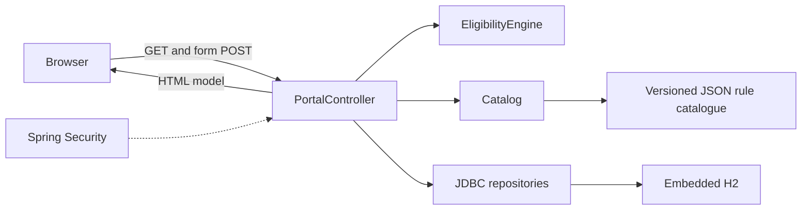
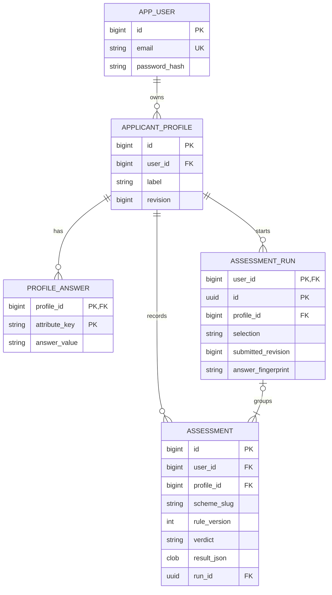

# Design notes

## Request flow

A Spring MVC controller selects the scheme and relevant questions. It validates the submitted strings before passing a normalized map to the rule service. A signed-in check saves the profile answers, run and result snapshots in one JDBC transaction. HTTP 303 then directs the browser to a read-only result URL.

## Routes

| Method and route | Result |
| --- | --- |
| `GET /` | Scheme catalogue with optional `q` and `category` filters |
| `GET /sources` | Excerpts filtered by optional `q` and `scheme` |
| `GET /lab` | Run the PMFME example with optional `age`, and display the age and education comparisons without a database write |
| `GET /check/{slug}` | Form for one scheme or `all`, with optional signed-in `profile` |
| `POST /check/{slug}` | Validates input, returns a guest result or redirects a signed-in applicant to the saved run |
| `GET /register`, `POST /register` | Registration page and submission |
| `GET /login`, `POST /login`, `POST /logout` | Session sign-in and sign-out |
| `GET /dashboard` | Profiles plus recent saved results, with cursor pagination |
| `POST /dashboard/profiles` | Add a named household profile |
| `GET /dashboard/results/{id}` | Return an assessment owned by the signed-in account |
| `GET /dashboard/runs/{id}` | Return all results from one submission owned by the signed-in account |

## Server-rendered interface

`Catalog` provides category counts, filters the directory, defines translated answer choices, and groups the combined questionnaire by topic. Thymeleaf renders the result and submits standard browser forms, including the Rule Lab. The JavaScript updates the questionnaire progress and language labels without clearing its inputs. Both fonts are packaged with the app alongside their OFL notices.

## Rules and evidence

The bundled [catalogue](../src/main/resources/corpus/catalog.json) adapts the original GovAssist scheme packs at revision `5356615efb296e08ec186537e8a3485276112f2f`. The nine source packs include a synthetic fixture, so the Java catalogue contains eight schemes. For each scheme, it uses the highest numeric rule version available in that revision, then converts its conjunction into structured comparisons. The data includes excerpts, page numbers, and ministry URLs. PM SVANidhi and Ujjwala use revision 2 of their rule packs. The age input is limited to 0–130 completed years as a data-entry check.

Each comparison reads one attribute. A condition can compare more than one attribute. A known failing comparison makes the condition fail, even if another term is missing. With no failure, a missing comparison makes the condition unknown. The scheme matches only when every condition passes. Each comparison stores the submitted value, operator, expected value and state. The catalogue checks that operands match the question type and that evidence points to a positive PDF page and an HTTP(S) URL. PMFME declares an individual-applicant scope condition by ID. A group application receives a separate track result even if the condition order changes.

| Decision | Meaning |
| --- | --- |
| `MATCH` | All recorded criteria passed |
| `NEEDS_INFO` | No known failure, with one or more unanswered comparisons |
| `NO_MATCH` | At least one recorded criterion failed |
| `OUTSIDE_SCOPE` | The applicant selected a route outside PMFME individual-unit support |

## Persistence

Answers are keyed by profile and question, so one saved answer can be reused across schemes. A blank value removes the saved answer for that question. An assessment stores individual comparisons, the original source excerpts, the used answers, and the rule version as a JSON snapshot. Earlier rows still open after the schema upgrade. Those rows contain criterion states and citations as originally recorded.

## Submission consistency

1. The form carries a random submission UUID and the revision of the profile answers it displays.
2. The save transaction locks the profile row. If that UUID already belongs to an identical request, it returns the existing run. The fingerprint compares normalized answers in key order, so equivalent numeric input such as `60` and `060` is a retry.
3. For a fresh UUID, the submitted revision must equal the locked revision. A mismatch returns HTTP 409 with a link to the latest answers.
4. For a valid new submission, the transaction inserts the run and result rows, updates the relevant answers, and increments the profile revision. A failed write rolls everything back. The browser then loads the run with GET, so refresh performs no write.

Every profile and result lookup is scoped to the authenticated account. A composite database foreign key guards assessment ownership. Spring Security protects signed-in routes and forms with session authentication and CSRF tokens. The registered password is salted and hashed with BCrypt.

## Reference documentation

- [Java SE 17 PreparedStatement](https://docs.oracle.com/en/java/javase/17/docs/api/java.sql/java/sql/PreparedStatement.html)
- [Java SE 17 BigDecimal](https://docs.oracle.com/en/java/javase/17/docs/api/java.base/java/math/BigDecimal.html)
- [Spring Boot 3.5 reference](https://docs.spring.io/spring-boot/3.5/)
- [Thymeleaf 3.1 guide](https://www.thymeleaf.org/doc/tutorials/3.1/usingthymeleaf.html)
- [H2 Database Engine features](https://h2database.com/html/features.html)
- [Maven Wrapper documentation](https://maven.apache.org/tools/wrapper/)
