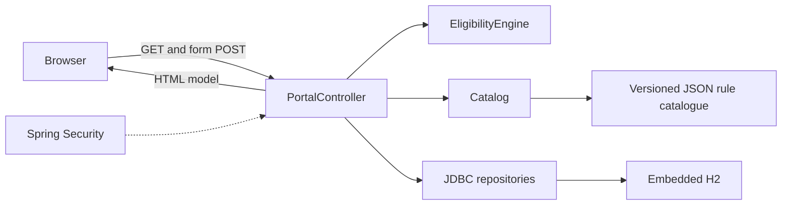
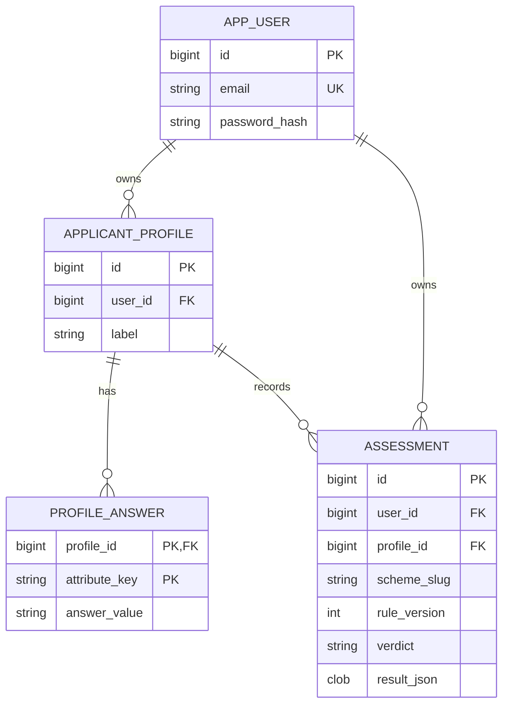

# Design notes

## Request flow

A Spring MVC controller selects the scheme and relevant questions. It validates the submitted strings before passing a normalized map to the rule service. Thymeleaf renders the result. For a signed-in applicant, the same request updates the selected profile and writes its result snapshots in one JDBC transaction.

## Routes

| Method and route | Result |
| --- | --- |
| `GET /` | Scheme catalogue with optional `q` filter |
| `GET /sources` | Excerpts filtered by optional `q` and `scheme` |
| `GET /check/{slug}` | Form for one scheme or `all`, with optional signed-in `profile` |
| `POST /check/{slug}` | Validated, cited screening result. Saves when signed in |
| `GET /register`, `POST /register` | Registration page and submission |
| `GET /login`, `POST /login`, `POST /logout` | Session sign-in and sign-out |
| `GET /dashboard` | Profiles plus recent saved results, with cursor pagination |
| `POST /dashboard/profiles` | Add a named household profile |
| `GET /dashboard/results/{id}` | Return an assessment owned by the signed-in account |

## Rules and evidence

The bundled [catalogue](../src/main/resources/corpus/catalog.json) adapts the original GovAssist scheme packs at revision `5356615efb296e08ec186537e8a3485276112f2f`. The nine source packs include a synthetic fixture, so the Java catalogue contains eight schemes. For each scheme, it uses the highest numeric rule version available in that revision, then converts its conjunction into structured comparisons. The data includes excerpts, page numbers, and ministry URLs. PM SVANidhi and Ujjwala use revision 2 of their rule packs. The age input is limited to 0–130 completed years as a data-entry check.

Each comparison reads one attribute. A condition can compare more than one attribute. A known failing comparison makes the condition fail, even if another term is missing. With no failure, a missing comparison makes the condition unknown. The scheme matches only when every condition passes. PMFME group and cooperative applicants receive a separate track result because the catalogue screens individual-unit support.

| Decision | Meaning |
| --- | --- |
| `MATCH` | All recorded criteria passed |
| `NEEDS_INFO` | No known failure, with one or more unanswered comparisons |
| `NO_MATCH` | At least one recorded criterion failed |
| `OUTSIDE_SCOPE` | The applicant selected a route outside PMFME individual-unit support |

## Persistence

Answers are keyed by profile and question, so one saved answer can be reused across schemes. A blank value removes the saved answer for that question. An assessment stores the rendered criterion states, the original source excerpts, the used answers, and the rule version as a JSON snapshot. Opening an old result leaves it independent of later answer changes.

Every profile and result lookup is scoped to the authenticated account. A composite database foreign key guards assessment ownership. Spring Security protects signed-in routes and forms with session authentication and CSRF tokens. The registered password is salted and hashed with BCrypt.

## Reference documentation

- [Java SE 17 PreparedStatement](https://docs.oracle.com/en/java/javase/17/docs/api/java.sql/java/sql/PreparedStatement.html)
- [Java SE 17 BigDecimal](https://docs.oracle.com/en/java/javase/17/docs/api/java.base/java/math/BigDecimal.html)
- [Spring Boot 3.5 reference](https://docs.spring.io/spring-boot/3.5/)
- [Thymeleaf 3.1 guide](https://www.thymeleaf.org/doc/tutorials/3.1/usingthymeleaf.html)
- [H2 Database Engine features](https://h2database.com/html/features.html)
- [Maven Wrapper documentation](https://maven.apache.org/tools/wrapper/)
